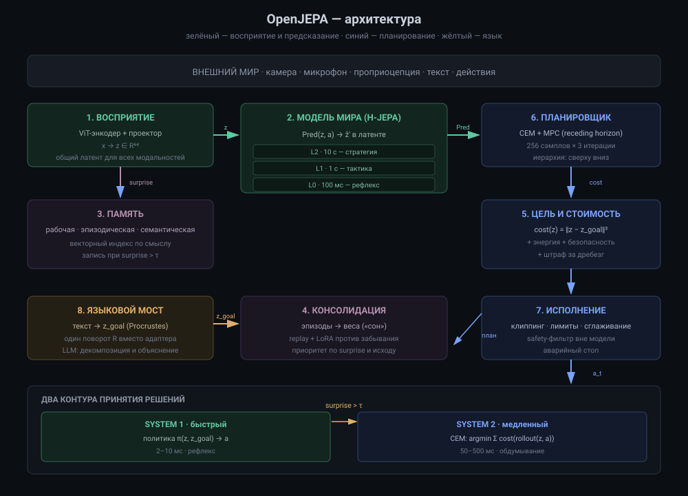

# 03. Архитектура OpenJEPA

> Это центральный документ. Здесь собирается всё: восприятие, модель мира,
> память, планирование, язык и исполнение — в одну систему с явными
> интерфейсами.



## 1. Коротко

OpenJEPA — это **не одна нейросеть**, а контур из семи модулей, у которых
общий латентный язык. Ядро — иерархическая модель мира на JEPA. Вокруг неё:
восприятие, память, целеобразование, планировщик, исполнение и языковой мост.

Три тезиса, на которых держится конструкция:

1. **Интеллект = предсказание последствий + планирование в абстракции.**
   Язык — интерфейс, а не субстрат.
2. **Один латентный язык для всех модальностей.** Это не удобство, а
   следствие теоремы о платоновских представлениях [arXiv:2610.39302]:
   JEPA, обученные на разных модальностях с «хорошими видами», сходятся
   к одному представлению с точностью до поворота.
3. **Два контура принятия решений.** Быстрый рефлекс и медленное обдумывание,
   переключение по ошибке предсказания.

---

## 2. Принципы проектирования

| # | Принцип | Следствие в коде |
|---|---|---|
| 1 | Предсказываем в латенте, не в пикселях | нет декодера, `JEPA.rollout` возвращает `(B,H+1,D)` |
| 2 | Никаких скрытых эвристик в обучении | SIGReg вместо stop-grad/EMA; один гиперпараметр `lamb` |
| 3 | Модули общаются только через явные интерфейсы | каждый модуль принимает/возвращает тензоры фиксированной формы |
| 4 | Иерархия по времени, а не по слоям | `HJEPA.strides = [1, 4, 16]` |
| 5 | Ошибка предсказания — сигнал первого класса | `Engine.surprise()` управляет переключением контуров |
| 6 | Всё, что можно проверить, проверяется тестом | `tests/` покрывает формы, физику, планировщик |

---

## 3. Схема системы

```
┌────────────────────────────────────────────────────────────────────────┐
│                            ВНЕШНИЙ МИР                                 │
│                  камера · микрофон · проприоцепция · текст             │
└──────────┬───────────────────────────────────────────────┬─────────────┘
           │ x_t                                           │ a_t
           ▼                                               ▲
┌────────────────────────┐                        ┌────────┴──────────┐
│ 1. ВОСПРИЯТИЕ          │                        │ 7. ИСПОЛНЕНИЕ     │
│ Enc_vision, Enc_audio  │                        │ клиппинг, лимиты, │
│ Enc_proprio, Enc_text  │                        │ safety-фильтр     │
└───────────┬────────────┘                        └────────▲──────────┘
            │ z_t ∈ R^D (общий латент)                     │
            ▼                                              │
┌──────────────────────────────────┐             ┌─────────┴─────────┐
│ 2. МОДЕЛЬ МИРА (H-JEPA)          │  подцели    │ 6. ПЛАНИРОВЩИК    │
│                                  │────────────>│ CEM / MPC         │
│  L2  10 с   ─┐                   │             │ иерархия сверху   │
│  L1  1 с    ─┼──> Pred(z, a)     │             │ вниз              │
│  L0  100 мс ─┘                   │             └─────────▲─────────┘
└───────────┬──────────────────────┘                       │
            │ surprise = ‖ẑ - z‖                           │ цель z_g
            ▼                                              │
┌──────────────────────────────────┐             ┌─────────┴─────────┐
│ 3. ПАМЯТЬ                        │  recall     │ 5. ЦЕЛЬ / ЭНЕРГИЯ │
│ рабочая: буфер z                  │────────────>│ cost(z, z_g)      │
│ эпизодическая: (z, t, контекст)   │             │ + внутренние cost │
│ семантическая: медленные веса     │             └─────────▲─────────┘
└───────────┬──────────────────────┘                       │
            │ консолидация                                 │
            ▼                                              │
┌──────────────────────────────────┐             ┌─────────┴─────────┐
│ 4. КОНСОЛИДАЦИЯ ОПЫТА            │             │ 8. ЯЗЫКОВОЙ МОСТ  │
│ дистилляция эпизодов в предиктор │             │ LLM ↔ латент      │
└──────────────────────────────────┘             └───────────────────┘
```

Стрелки — это **тензоры**, а не «вызовы функций». Каждый интерфейс описан ниже.

---

## 4. Модули и интерфейсы

### 4.1 Восприятие (Perception)

**Задача:** превратить сырые наблюдения в общий латентный вектор.

```python
z_t = Enc_modality(x_t)          # (B, D)
```

| Модальность | Энкодер | Вход | Выход |
|---|---|---|---|
| видео/изображение | ViT (patch 8/14/16) | `(B,T,3,H,W)` | `(B,T,D)` |
| аудио | 1D-conv + ViT | `(B,T,1,S)` | `(B,T,D)` |
| проприоцепция | MLP | `(B,T,P)` | `(B,T,D)` |
| текст | токенный ViT/transformer | `(B,T,L)` | `(B,T,D)` |

**Ключевое решение:** все энкодеры проецируются в **одно** пространство `R^D`
и обучаются JEPA-целью на парах «два вида одной сцены». Это и есть механизм,
который по теореме даёт выравнивание с точностью до поворота.

В нашем коде реализован только визуальный энкодер (`models/vit.py`).
Остальные — та же схема с другим `PatchEmbed`.

**Тензорные детали:**

```
ViTEncoder: (B,C,H,W) -> (B,192)      # image
            (B,T,C,H,W) -> (B,T,192)  # video
Projector:  (...,192) -> (...,64)     # пространство предсказания
```

Проектор нужен, потому что «широкий» признак энкодера (192) и «узкое»
пространство предсказания (64) — разные роли. SIGReg натягивает на гауссиан
именно `proj_dim`, а не признак энкодера.

### 4.2 Модель мира (World Model)

**Задача:** по текущему латенту и действию предсказать латент будущего.

```python
ẑ_{t+k} = Pred_k(z_t, a_{t:t+k})     # (B, D)
```

Реализация — `models/predictor.py`:

```
LatentPredictor:
  action_enc:  (B,A) -> (B,384)
  inp:         (B,64) -> (B,384)
  FiLMBlock × 3:  h <- h + MLP(LN(h) * (1+γ(a)) + β(a))
  out:         (B,384) -> (B,64)
  residual:    ẑ = z + out
```

**Почему FiLM, а не конкатенация.** Конкатенация `[z, a]` меняет входную
размерность при изменении набора действий и ломает residual-поток. FiLM
модулирует признаки, оставляя сеть residual: на старте (нулевая инициализация
`film`) предиктор тождественен, и обучение начинается с малых поправок.

**Почему нулевая инициализация выхода.** Стандартный приём из DiT: модель
начинает как identity, поэтому начальная ошибка предсказания равна
`‖z_{t+1} - z_t‖`, а не случайному шуму. Это сильно стабилизирует первые
тысячи шагов.

### 4.3 Иерархия (H-JEPA)

**Задача:** предсказывать на разных временных масштабах.

```python
# models/hierarchy.py
HJEPA(strides=[1, 4, 16])
  общий энкодер
  predictors[0]: горизонт 1 кадр   (~100 мс)
  predictors[1]: горизонт 4 кадра  (~1 с)
  predictors[2]: горизонт 16 кадров(~10 с)
```

Обучение: для уровня `s` берётся пара `(z_t, z_{t+s})`, а действие —
среднее по окну `s` (макро-действие). Планирование идёт сверху вниз:
верхний уровень выдаёт подцель, нижний превращает её в действие.

**Почему это работает.** Факторы, меняющиеся на разных скоростях, разделяются:
верхние уровни выбрасывают быстрые непредсказуемые детали и сохраняют
медленное, релевантное задаче состояние. Эмпирика: на Visual AntMaze
трёхуровневая иерархия поднимает успех с **18% до 73%** при *меньшем*
бюджете планирования [arXiv:2610.06805].

### 4.4 Память (Memory)

**Задача:** хранить опыт дольше, чем длится контекст предиктора.

Три уровня, как в когнитивной науке:

| Уровень | Что хранит | Время жизни | Реализация |
|---|---|---|---|
| рабочая | последние `N` латентов `z` | секунды | кольцевой буфер в RAM |
| эпизодическая | `(z, t, действие, surprise)` | дни | векторный индекс (FAISS/HNSW) |
| семантическая | обобщённые закономерности | постоянно | медленные веса предиктора |

**Механизм консолидации:** периодически сэмплируем эпизоды с высоким
`surprise`, проигрываем их через предиктор и делаем несколько шагов
градиента. Это «сон»: перевод эпизодической памяти в семантическую.

Подробно — `07-pamyat.md`. В коде пока не реализовано (см. статус в README).

### 4.5 Цель и энергия (Cost / Energy)

**Задача:** определить, «хорошо» или «плохо» текущее состояние.

```python
cost(z) = ‖z - z_goal‖²  +  λ_energy·E(z)  +  λ_safety·S(z)
```

* `z_goal` — целевой латент (из кадра-цели, из языка, из памяти);
* `E(z)` — внутренняя стоимость: расход энергии, отклонение от «нормальных»
  состояний (можно оценивать как расстояние до manifold'а обучающих данных);
* `S(z)` — штраф за опасные состояния (обучается на размеченных авариях
  или задаётся правилами).

В статье 2022 года это называется **cost module**; в терминах энергетических
моделей — энергия, которую минимизирует планировщик.

### 4.6 Планировщик (Planner)

**Задача:** найти последовательность действий, минимизирующую стоимость.

```python
actions = CEM(Pred, z_t, z_goal, horizon=H)   # (B,H,A)
```

Реализация — `planning/cem.py`. Три итерации CEM с 256 сэмплами и 32 элитными
вариантами находят приемлемое решение за единицы миллисекунд на GPU.

**Почему CEM, а не градиент.** Среда за предиктором недифференцируема по
действиям: отскоки, контакты, переключения режимов. CEM не требует
дифференцируемости и устойчив к разрывам.

**Почему MPC.** План на 8 шагов почти всегда устаревает после первого шага.
Receding horizon: планируем, исполняем один шаг, перепланируем. `planning/mpc.py`.

### 4.7 Исполнение (Execution)

**Задача:** превратить «идеальное» действие в безопасное физическое.

```python
a_safe = clip(a, limits)
a_safe = safety_filter(a_safe, state)   # аппаратные ограничения
```

Здесь же — антидребезг, сглаживание, ограничение скорости нарастания.

### 4.8 Языковой мост (Language Bridge)

**Задача:** связать символы с латентом.

```python
z_goal = TextEncoder("поставь чашку слева от тарелки")   # (D,)
caption = LatentDecoder(z)                                # текст
```

Два направления:

1. **Инструкция → цель.** LLM разбирает инструкцию на подзадачи, каждая подзадача
   отображается в точку латентного пространства через обученный адаптер.
2. **Латент → объяснение.** Обратное отображение для отладки и доверия.

**Ключевое:** LLM здесь не принимает решений о физике. Он переводит
человеческий язык в цель и объясняет, что произошло. Подробно — `08-yazyk-i-llm.md`.

---

## 5. Два контура: System 1 и System 2

```
                 ┌──────────────────────────────┐
      z_t ──────>│  быстрый контур (политика)   │──────> a_t   ~2-10 мс
                 │  π(z_t, z_goal) -> a         │
                 └──────────────┬───────────────┘
                                │ если surprise > τ
                                ▼
                 ┌──────────────────────────────┐
                 │  медленный контур (CEM/MPC)  │──────> a_t   ~50-500 мс
                 │  argmin Σ cost(rollout)      │
                 └──────────────────────────────┘
```

**Порог `τ`** — единственный переключатель. Если модель предсказала следующий
эмбеддинг с ошибкой ниже порога, мир «идёт по плану» — хватает рефлекса.
Если выше — что-то новое или опасное — включается обдумывание.

В коде: `Engine.surprise(obs)` возвращает `‖Pred(z_{t-1}, a_{t-1}) - z_t‖`.
`RuntimeConfig.surprise_threshold` задаёт порог.

Это дешёвая аппроксимация метакогниции: система знает, когда она не знает.

---

## 6. Как это обучается: шесть стадий

| Стадия | Что учим | Данные | Сигнал | Стоимость (порядок) |
|---|---|---|---|---|
| **A. Восприятие** | энкодер | видео/картинки | JEPA + SIGReg | 10²–10⁴ GPU·ч |
| **B. Динамика** | предиктор | видео + действия | JEPA + SIGReg | 10²–10³ GPU·ч |
| **C. Иерархия** | предикторы уровней | длинные траектории | JEPA по масштабам | 10² GPU·ч |
| **D. Политика** | быстрый контур | планы CEM | дистилляция | 10¹ GPU·ч |
| **E. Язык** | адаптер | пары (текст, латент) | контрастивный/поворот | 10¹–10² GPU·ч |
| **F. Консолидация** | предиктор | эпизоды с высоким surprise | JEPA + replay | постоянно |

**Стадия A** в нашем репозитории не реализована на реальных данных — только
на игрушечной среде (стадии B). Это осознанно: цель репозитория — дать
работающий скелет, а не обучить фундаментную модель.

**Порядок важен.** Нельзя учить политику до того, как модель мира хоть
что-то предсказывает: дистилляция мусорных планов даёт мусорную политику.

---

## 7. Где что лежит в коде

| Модуль | Файл | Ключевой класс |
|---|---|---|
| Восприятие | `models/vit.py` | `ViTEncoder`, `Projector` |
| Модель мира | `models/predictor.py` | `LatentPredictor` |
| Сборка + лосс | `models/jepa.py` | `JEPA`, `JEPAConfig` |
| Иерархия | `models/hierarchy.py` | `HJEPA` |
| Регуляризация | `losses/sigreg.py` | `SIGReg` |
| Среда | `data/synthetic.py` | `BallEnv`, `TrajectoryDataset` |
| Обучение | `train/pretrain.py` | `train()` |
| Планирование | `planning/cem.py` | `CEMPlanner` |
| MPC | `planning/mpc.py` | `LatentMPC` |
| Рантайм | `runtime/engine.py` | `OpenJEPAEngine` |
| CLI/HTTP | `runtime/cli.py` | `main()` |

---

## 8. Что дальше

* Детали модели мира и почему именно такие слои — `04-model-mira.md`.
* Почему обучение не разваливается — `05-obuchenie.md`.
* Как планировщик превращает латент в действие — `06-planirovanie.md`.
* Как это упаковать в сервис — `09-runtime.md`.

---

## 9. Чеклист

- [ ] Могу нарисовать схему из 8 блоков по памяти.
- [ ] Понимаю, зачем общий латентный язык для всех модальностей.
- [ ] Знаю, чем System 1 отличается от System 2 и что переключает контуры.
- [ ] Помню, что память и язык — отдельные модули, а не «свойства JEPA».
